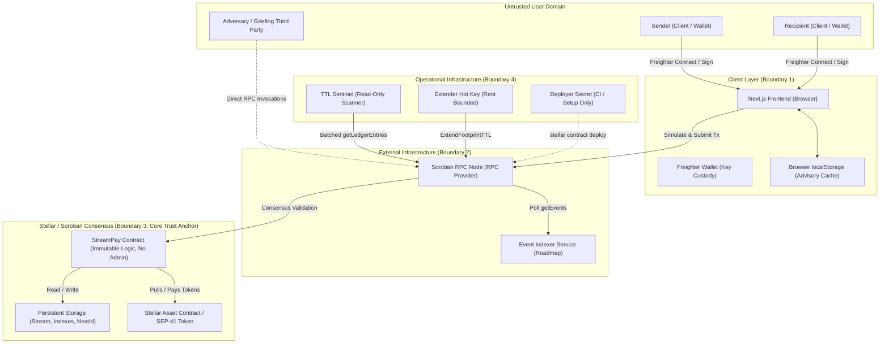

# StreamPay Threat Model: Adversary × Component Security Matrix

- **Document Version**: 1.0.0-draft
- **Pinned Commit**: `0846c879db1312d4a08bbf7099349822fc66ced4`
- **Date**: 2026-10-15
- **Status**: Draft for External Audit Intake (Pairs with Issue #13 / Audit Prep)
- **Target Network**: Stellar Mainnet (Soroban Protocol 23 / Protocol 24+)

---

## 1. Purpose and How to Use This Document

This document is the authoritative **threat model and audit-intake specification** for the StreamPay protocol. It pairs with issue #13 (external audit intake and security readiness) and is designed to provide auditors and security evaluators with unambiguous scoping boundaries, an exhaustive adversarial threat matrix, precise invariant definitions, and verified evidence citations.

### Intended Audience and Scope Orientation
An external auditor reviewing StreamPay should use this document to:
1. **Clarify Scope Boundaries**: Eliminate guesswork regarding what is formally guaranteed by the smart contract versus what is an accepted operational or external risk.
2. **Review Invariant Adherence**: Test every contract entrypoint, branch, and edge case against the mathematical and architectural invariants defined in [§4](#4-assets-and-security-invariants).
3. **Verify the Adversary × Component Matrix**: Evaluate how each of the 7 identified adversary classes is countered across the 4 architectural components in [§7](#7-the-adversary--component-matrix).
4. **Inspect Unmitigated & Partially Mitigated Gaps**: Review pre-identified residual risks in [§9](#9-accepted-open-risks-register) and ready-to-file security enhancements in [§11](#11-gap-issues).
5. **Analyze Full State Exposure**: Review the candid evaluation of on-chain information leakage in [§10](#10-the-honest-weakness-full-contract-state-exposure).

---

## 2. System Overview, Components, and Trust Boundaries

StreamPay provides continuous, per-second linear payment streaming on the Stellar network using the Soroban smart contract framework. Senders deposit tokens into escrow, which accrue linearly to a designated recipient between a start timestamp and an end timestamp. Recipients can withdraw accrued funds continuously; senders or cancelable recipients can terminate streams with a fair pro-rata refund.

### 2.1 Core Components

| Component | Repository Path | Tech Stack | Role & Responsibility |
|---|---|---|---|
| **Contract** | `contracts/streaming-payments/` | Rust, `soroban-sdk` 28.0.0 | Immutable escrow engine. Enforces auth checks (`require_auth`), monotonic stream ID assignment, capacity validation, linear accrual math, Checks-Effects-Interactions (CEI) token transfers, event emission, and persistent storage management. |
| **Frontend** | `frontend/` | Next.js 16 (App Router), React 19, TypeScript, `@stellar/stellar-sdk`, `@stellar/freighter-api` | Non-custodial client interface. Connects to Freighter wallet, discovers user streams via on-chain indexes, estimates transaction resources, simulates calls against Soroban RPC, and submits signed XDR envelopes. |
| **Indexer** | Roadmap (spec in `docs/GOOD_FIRST_ISSUES.md:65-85`, drill simulation in `scripts/drill_indexer_corruption.sh`) | TypeScript / Node.js worker + SQLite/Postgres | Asynchronous off-chain worker. Ingests contract events (`StreamCreated`, `Withdrawn`, `StreamCancelled`, `StreamToppedUp`) via RPC `getEvents`, indexes historical state transitions, and serves analytical queries. |
| **Ops Keys / Sentinel** | `infra/ttl-sentinel/`, `scripts/deploy_*.sh`, `.github/workflows/promote.yml` | TypeScript / Node.js, Shell, GitHub Actions | Operational infrastructure. Manages Wasm deployment, continuous storage TTL monitoring (`ttl-sentinel`), cliff projections, and automated rent extension transactions (`ExtendFootprintTTL`). |

### 2.2 System Architecture and Trust Boundaries



### 2.3 Explicit Trust Boundaries

1. **Boundary 1 (User / Client Wallet)**:
   - *Untrusted*: Raw browser DOM, user inputs, query parameters, local storage.
   - *Trusted*: Cryptographic key isolation inside user wallet software (e.g. Freighter, hardware wallet).
2. **Boundary 2 (Frontend & Indexer to RPC Provider)**:
   - *Untrusted*: Network transit, RPC node availability, transaction simulation latency.
   - *Partially Trusted*: Soroban RPC endpoint (expected to forward canonical consensus data, but modeled as potentially lying or stale).
3. **Boundary 3 (Consensus Host / Smart Contract)**:
   - *Fully Trusted*: Stellar validator quorum, Soroban Host environment, `env.ledger().timestamp()`, cryptographic signature verification (`require_auth`).
   - *Untrusted*: External token contracts that do not conform to canonical Stellar Asset Contract (SAC) invariants.
4. **Boundary 4 (Ops Infrastructure to Chain)**:
   - *Trusted*: Secret storage in GitHub Secrets (`MAINNET_DEPLOYER_SECRET`) and isolated host environment variables (`TTL_SENTINEL_EXTENDER_SECRET`).
   - *Constraint*: Operational keys hold **zero** administrative or upgrade authority over the deployed contract.

---

## 3. Assets and Security Invariants

### 3.1 Protected Assets

| Asset ID | Asset Name | Form / Location | Impact of Loss / Corruption |
|---|---|---|---|
| **A-1** | Escrowed Stream Funds | Tokens held in the StreamPay contract account balance (`TokenClient::balance(&contract)`) | Critical: Direct financial loss to senders or recipients. |
| **A-2** | Stream State Integrity | Persistent storage entries `DataKey::Stream(u64)` storing deposit, withdrawn amounts, timestamps, addresses, and status | Critical: State desynchronization, double-spending, or premature withdrawal. |
| **A-3** | Monotonic Counter | `DataKey::NextStreamId` persistent storage entry | High: Stream ID collisions or denial of stream creation. |
| **A-4** | Discovery Indexes | `DataKey::RecipientStreams(Address)` and `DataKey::SenderStreams(Address)` vector entries | Medium: Loss of client-side stream discoverability (advisory only; stream records remain source of truth). |
| **A-5** | Contract Bytecode & Instance | Wasm executable code and contract instance ledger entries | Critical: Contract bricking / denial of service if un-extended past 4,095 ledgers. |
| **A-6** | User Signing Keys | Ed25519 private keys controlling sender and recipient Stellar accounts | Critical: Unauthorized stream creation, cancellation, or fund diversion. |
| **A-7** | Operational Rent Keys | Extender account secret key funding `ExtendFootprintTTL` transactions | Medium: Depletion of operational XLM rent budget. |

### 3.2 Formal Security Invariants

Every audit test and formal verification pass must prove the following invariants hold under all execution paths:

#### Invariant 1: Individual Stream Rate Conservation and Boundedness
For every stored stream $S$ at any ledger timestamp $t$:
$$0 \le S.\text{withdrawn} \le \text{streamed\_at}(S.\text{deposit}, S.\text{duration}, \text{elapsed}(t)) \le S.\text{deposit}$$
- Before `start_time` ($\text{elapsed} = 0$): $\text{withdrawn} = 0$, $\text{streamed} = 0$.
- After `end_time` ($\text{elapsed} \ge \text{duration}$): $\text{streamed} = S.\text{deposit}$.
- For active streams: unwithdrawn balance $\text{available} = \text{streamed} - S.\text{withdrawn} \ge 0$.

#### Invariant 2: Global Solvency and Balance Coverage
Across all live streams funded in token $T$:
$$\text{TokenClient}(T).\text{balance}(\text{contract\_address}) \ge \sum_{S \in \text{LiveStreams}(T)} (S.\text{deposit} - S.\text{withdrawn})$$
Tokens enter the contract *only* through `create_stream` (`transfer_from`) and `top_up` (`transfer_from`), and exit *only* through `withdraw`/`withdraw_max` (`transfer`) and `cancel_stream` (`transfer`). No unbacked credit or yield minting exists.

#### Invariant 3: Checks-Effects-Interactions (CEI) & Reentrancy Immunity
All internal state mutations (updating $S.\text{withdrawn}$, mutating status to `StreamStatus::Depleted` or `StreamStatus::Cancelled`, updating $S.\text{deposit}$) and event emissions must be committed to storage (`stream::put_stream`) **before** invoking external token transfer contracts (`TokenClient::transfer` or `TokenClient::transfer_from`).

#### Invariant 4: Monotonic Accrual and Non-Decreasing Availability
For any valid deposit $D > 0$ and duration $L > 0$, the accrual function is strictly monotonic non-decreasing with respect to elapsed time:
$$\forall t_1 \le t_2: \quad \text{streamed\_at}(D, L, t_1) \le \text{streamed\_at}(D, L, t_2)$$
Accrual floor division ensures remainder dust accumulates to the recipient at $t = L$, guaranteeing exact conservation: $\text{streamed\_at}(D, L, L) = D$.

#### Invariant 5: Irreversibility of Terminal States
Lifecycle states `StreamStatus::Cancelled` and `StreamStatus::Depleted` are strictly terminal. No subsequent invocation of `withdraw`, `withdraw_max`, `cancel_stream`, or `top_up` can mutate state or transfer tokens on a terminal stream.

#### Invariant 6: Monotonicity and Uniqueness of Stream IDs
Every new stream is assigned $ID_{k+1} = ID_k + 1$, where IDs begin at 1. No stream ID can ever be reused or re-assigned.

#### Invariant 7: Panic Freedom and Error Code Stability
The contract must never trigger an unhandled Soroban host panic on valid or invalid user inputs. Every rejection must return a typed `Result<_, StreamError>` matching the numeric codes documented in `docs/ERRORS.md`.

---

## 4. Roles and Privileges

StreamPay enforces a **strictly trust-minimized, ownerless architecture**. There is intentionally **no admin key**, **no contract owner**, and **no upgrade mechanism** on-chain.

| Role | Key / Identity | Authorization Mechanism | Permitted Entrypoints & Capabilities |
|---|---|---|---|
| **Sender** | Stellar Account (Ed25519) | `sender.require_auth()` | - `create_stream`: Locks initial deposit from sender account.<br>- `cancel_stream`: Terminates active stream; claims pro-rata refund.<br>- `top_up`: Adds deposit tokens to active stream.<br>- Read `sender_streams`. |
| **Recipient** | Stellar Account (Ed25519) | `recipient.require_auth()` | - `withdraw`: Withdraws accrued tokens up to `available`.<br>- `withdraw_max`: Atomically claims 100% of accrued tokens.<br>- `cancel_stream`: Terminates stream iff `cancelable == true`.<br>- Read `recipient_streams`. |
| **Unauthenticated User / Third Party** | Any Stellar Account | None | - Read-only queries: `get_stream`, `available`, `recipient_streams`, `sender_streams`.<br>- Cannot cancel, withdraw, or top up streams without authorized signatures. |
| **Contract Admin / Multisig** | **NONE** | **N/A** | **Does not exist.** The contract has no administrative backdoors, pause switches, fee parameters, or blacklists. |
| **Upgrade Authority** | **NONE** | **N/A** | **Does not exist.** The Wasm bytecode cannot be updated in place. Fixes require deploying a new contract ID. |
| **Deployer / CI Key** | `MAINNET_DEPLOYER_SECRET` / `deployer` | Stellar CLI transaction signer | - Performs initial `stellar contract deploy`.<br>- **Zero** privileges post-deployment. Cannot modify contract storage or state. |
| **TTL Sentinel Operator** | `TTL_SENTINEL_EXTENDER_SECRET` | Stellar transaction signer | - Submits protocol-level `ExtendFootprintTTL` transactions to prevent state archival.<br>- Cannot access contract storage, modify balances, or divert funds. |
| **Token Issuer** | External Asset Issuer | Token contract rules (SAC) | - Governed by external token contracts.<br>- In SAC tokens, may possess `freeze` or `clawback` authority over user trustlines. |

---

## 5. Audit Scope Specification

### 5.1 In-Scope Components

```text
contracts/streaming-payments/
├── Cargo.toml
└── src/
    ├── lib.rs                  # Public contract entrypoints & auth verification
    ├── stream.rs               # Stream lifecycle, storage handlers, accrual math
    ├── errors.rs               # StreamError enum & numeric code definitions
    ├── events.rs               # Event structs (StreamCreated, Withdrawn, etc.)
    ├── surface.rs              # Error-surface rejection matrix & branch instrumentation
    ├── test.rs                 # Comprehensive unit & integration test suite
    ├── error_surface_test.rs   # Exhaustive reachability matrix tests
    └── test_client.rs          # Test harness contract client bindings
```

### 5.2 Out-of-Scope Components

1. **Frontend Application (`frontend/`)**: Next.js client UI and browser storage. Audited for integration assumptions and client-side validation, but not evaluated as a trust anchor.
2. **TTL Sentinel Service (`infra/ttl-sentinel/`)**: External TypeScript operational monitor. Evaluated for its ability to prevent state archival, but its hot keys hold no contract execution privileges.
3. **Deployment Shell Scripts (`scripts/`)**: Operational tooling for testnet rehearsals and canary checks.
4. **Stellar Core & Soroban Host VM**: Core protocol implementations (`rs-soroban-env`, CAP-0046, CAP-0066). Assumed bug-free and compliant with protocol specifications.
5. **Freighter Wallet Extension**: User key custody and transaction signing security.

### 5.3 Core Assumptions and Explicitly Trusted Parties

- **Consensus & Ledger Timestamps**: We explicitly trust the Stellar network consensus to produce monotonically non-decreasing ledger timestamps via `env.ledger().timestamp()`.
- **Cryptographic Signature Verification**: We assume `soroban_sdk::Address::require_auth()` reliably rejects forged or unauthorized signatures.
- **Token Contract Compliance**: The contract assumes tokens conform strictly to the standard Stellar Asset Contract (SAC) or SEP-41 token interface without arbitrary callbacks, fee-on-transfer deductions, or dynamic rebasing.

---

## 6. The Adversary × Component Matrix

The threat model evaluates **7 Adversaries** across **4 Components** (28 distinct threat vectors).

### 6.1 Matrix Summary Table

| Adversary | Contract | Frontend | Indexer | Ops Keys |
|---|---|---|---|---|
| **1. Malicious Recipient** | **MITIGATED** | **PARTIALLY MITIGATED** | **PARTIALLY MITIGATED** | **N/A (Reason: Isolation)** |
| **2. Malicious Sender** | **MITIGATED** | **PARTIALLY MITIGATED** | **ACCEPTED RISK** | **N/A (Reason: Isolation)** |
| **3. Stolen Keys** | **PARTIALLY MITIGATED** | **PARTIALLY MITIGATED** | **PARTIALLY MITIGATED** | **MITIGATED** |
| **4. Hostile Token Contract** | **PARTIALLY MITIGATED** | **OPEN** | **ACCEPTED RISK** | **N/A (Reason: Isolation)** |
| **5. RPC Liar** | **MITIGATED** | **PARTIALLY MITIGATED** | **PARTIALLY MITIGATED** | **MITIGATED** |
| **6. Indexer Compromiser** | **MITIGATED** | **PARTIALLY MITIGATED** | **PARTIALLY MITIGATED** | **N/A (Reason: Isolation)** |
| **7. Griefing Third Party** | **PARTIALLY MITIGATED** | **PARTIALLY MITIGATED** | **ACCEPTED RISK** | **ACCEPTED RISK** |

---

### 6.2 Detailed Per-Adversary Subsections

```mermaid
matrix
%% Conceptual relationship between Adversary and Component
```

#### Row 1: Malicious Recipient
An untrusted recipient attempting to extract more funds than accrued, drain other streams, or disrupt the protocol.

- **Cell 1.1: Malicious Recipient × Contract**
  - **Consequence**: Premature withdrawal of unearned deposit, double-withdrawal of accrued funds, reentrant drain during payout callback, or unauthorized cancellation of non-cancelable streams. (Severity: **Critical**).
  - **Existing Mitigations**:
    1. `authorize_withdrawal` verifies caller identity via `s.recipient.require_auth()` (`contracts/streaming-payments/src/lib.rs:197`).
    2. Mathematical accrual clamp in `stream::available_amount` floored to whole units; rejects amounts exceeding available via `Branch::WithdrawAmountExceedsAvailable` (`contracts/streaming-payments/src/lib.rs:166-168`).
    3. Strict CEI pattern in `pay_out`: state is updated (`s.withdrawn += amount`, status set to `Depleted` if full) and persisted to storage *before* calling `token.transfer` (`contracts/streaming-payments/src/lib.rs:208-230`).
    4. Cancellation gate: recipient cannot call `cancel_stream` unless `s.cancelable == true` (`contracts/streaming-payments/src/lib.rs:249-251`).
    5. Rejection of mutations on terminal streams (`Branch::StreamNotActive`) (`contracts/streaming-payments/src/lib.rs:198-200`).
  - **Status**: `MITIGATED`
  - **Evidence Citations**:
    - `contracts/streaming-payments/src/test.rs:446` (`fn withdraw_reverts_if_amount_exceeds_available()`)
    - `contracts/streaming-payments/src/test.rs:381` (`fn withdraw_before_start_returns_zero_and_reverts()`)
    - `contracts/streaming-payments/src/test.rs:513` (`fn withdraw_fails_without_recipient_authorization()`)
    - `contracts/streaming-payments/src/test.rs:534` (`fn withdraw_on_cancelled_stream_reverts()`)
    - `contracts/streaming-payments/src/test.rs:656` (`fn recipient_cannot_cancel_non_cancelable_stream()`)
    - `contracts/streaming-payments/src/test.rs:980` (`fn reentrant_withdrawal_during_payout_cannot_double_spend()`)
    - `contracts/streaming-payments/src/test.rs:1320` (`fn withdraw_max_before_start_reverts_nothing_to_withdraw()`)
    - `contracts/streaming-payments/src/test.rs:1371` (`fn withdraw_max_requires_recipient_authorization()`)

- **Cell 1.2: Malicious Recipient × Frontend**
  - **Consequence**: Recipient attempts to submit manipulated form inputs, bypass UI clamps, or trigger rapid duplicate requests to desynchronize UI state. (Severity: **Low**).
  - **Existing Mitigations**:
    1. UI clamps withdrawal inputs: checks `amount > available` and disables submission or presents contextual warnings (`frontend/app/stream/[id]/page.tsx:89-105`).
    2. Client transaction pipeline pre-simulates transactions using `simulateTransaction`; contract errors (`Error(Contract, #10)`) are intercepted and translated via `describeError` before wallet confirmation (`frontend/lib/stellar.ts:103-113`, `frontend/lib/stellar.ts:141-144`).
    3. Note: No proving automated frontend unit test suite exists in the repository.
  - **Status**: `PARTIALLY MITIGATED` (no proving test; see GAP-4)
  - **Evidence Citations**: Code at `frontend/app/stream/[id]/page.tsx:89-105`, `frontend/lib/stellar.ts:103-113`. Tracking issue: GAP-4.

- **Cell 1.3: Malicious Recipient × Indexer**
  - **Consequence**: High-frequency withdrawal polling or transaction spam aimed at desynchronizing the off-chain indexer or exhausting API rate limits. (Severity: **Low**).
  - **Existing Mitigations**:
    1. Contract emits discrete, stream-indexed events (`Withdrawn`, `StreamCancelled`) containing monotonic `withdrawn_total` counters (`contracts/streaming-payments/src/events.rs:25-33`).
    2. Indexer design ingests events sequentially using ledger cursors, discarding duplicate transactions (`docs/GOOD_FIRST_ISSUES.md:74-78`).
    3. Indexer resynchronization and database rebuild drill verified in `scripts/drill_indexer_corruption.sh`.
  - **Status**: `PARTIALLY MITIGATED` (no proving test; indexer service is a roadmap component; see GAP-5)
  - **Evidence Citations**: `scripts/drill_indexer_corruption.sh:61-71`, `docs/GOOD_FIRST_ISSUES.md:65-85`. Tracking issue: GAP-5.

- **Cell 1.4: Malicious Recipient × Ops Keys**
  - **Consequence**: Recipient attempts to manipulate deployment or rent maintenance keys to extract funds or grief ops. (Severity: **N/A**).
  - **Existing Mitigations**:
    1. Total architectural isolation: ops keys (`MAINNET_DEPLOYER_SECRET`, `TTL_SENTINEL_EXTENDER_SECRET`) reside in isolated CI/CD environments and host configuration (`.github/workflows/promote.yml:34-35`, `infra/ttl-sentinel/src/extender.ts:11-13`).
    2. The smart contract has no administrative or privileged entrypoints that ops keys could invoke even if compromised (`docs/INCIDENT_RUNBOOK.md:17-19`).
  - **Status**: `N/A (Isolation: recipient cannot interact with ops keys; ops keys possess no contract authority)`
  - **Evidence Citations**: Architectural rule in `docs/INCIDENT_RUNBOOK.md:17-19`, `.github/workflows/promote.yml:34-35`.

---

#### Row 2: Malicious Sender
An untrusted sender attempting to reclaim accrued funds, create unbacked streams, lock recipient capital, or abuse rate math.

- **Cell 2.1: Malicious Sender × Contract**
  - **Consequence**: Clawback of funds after accrual window, creation of unbacked streams without balance/allowance, arithmetic overflow resulting in locked escrow, or unrecoverable stream state. (Severity: **Critical**).
  - **Existing Mitigations**:
    1. Input parameter admission validation: `create_stream` requires `deposit_amount > 0`, `start_time >= now`, `end_time > start_time`, and `duration <= MAX_DURATION_SECONDS` (`contracts/streaming-payments/src/lib.rs:90-109`).
    2. Overflow capacity check: `stream::validate_capacity` enforces $\text{deposit} \le \lfloor u128::\text{MAX} / \text{duration} \rfloor$, preventing overflow in rate math (`contracts/streaming-payments/src/stream.rs:115-121`).
    3. Atomic deposit pull: `TokenClient::transfer_from` executes *before* stream creation; fails if sender balance or allowance is insufficient (`contracts/streaming-payments/src/lib.rs:112-117`).
    4. Fair pro-rata cancellation: `cancel_stream` pays recipient $100\%$ of accrued balance ($\text{streamed} - \text{withdrawn}$) and refunds sender only unaccrued remainder ($\text{deposit} - \text{streamed}$) (`contracts/streaming-payments/src/stream.rs:167-177`). Cancelling after `end_time` awards $100\%$ of remainder to recipient and $0$ to sender (`contracts/streaming-payments/src/lib.rs:281-298`).
    5. Terminal state lock: `cancel_stream` cannot be called twice (`contracts/streaming-payments/src/lib.rs:244-246`).
    6. Top-up capacity validation: `top_up` rejects negative/zero amounts and enforces capacity checks on new total deposit (`contracts/streaming-payments/src/lib.rs:317-331`).
  - **Status**: `MITIGATED`
  - **Evidence Citations**:
    - `contracts/streaming-payments/src/test.rs:143` (`fn create_stream_rejects_zero_and_negative_amounts()`)
    - `contracts/streaming-payments/src/test.rs:166` (`fn create_stream_rejects_zero_duration()`)
    - `contracts/streaming-payments/src/test.rs:187` (`fn create_stream_rejects_inverted_time_range()`)
    - `contracts/streaming-payments/src/test.rs:208` (`fn create_stream_rejects_start_time_in_the_past()`)
    - `contracts/streaming-payments/src/test.rs:246` (`fn create_stream_rejects_duration_over_max()`)
    - `contracts/streaming-payments/src/test.rs:297` (`fn create_stream_rejects_deposit_that_overflows_rate_math()`)
    - `contracts/streaming-payments/src/test.rs:356` (`fn create_stream_rejects_sender_without_balance_or_allowance()`)
    - `contracts/streaming-payments/src/test.rs:606` (`fn cancel_after_end_pays_recipient_everything()`)
    - `contracts/streaming-payments/src/test.rs:642` (`fn cancel_twice_reverts()`)
    - `contracts/streaming-payments/src/test.rs:823` (`fn top_up_rejected_on_cancelled_stream()`)
    - `contracts/streaming-payments/src/test.rs:852` (`fn top_up_rejects_zero_amount()`)
    - `contracts/streaming-payments/src/test.rs:865` (`fn top_up_rejects_amount_that_would_overflow_rate_math()`)

- **Cell 2.2: Malicious Sender × Frontend**
  - **Consequence**: Sender spams hundreds of 1-stroop streams to flood a recipient's UI index, causing browser pagination slowdowns or visual clutter. (Severity: **Medium**).
  - **Existing Mitigations**:
    1. UI enforces positive integer inputs and computes real-time start/end timestamps (`frontend/components/StreamForm.tsx:32-44`, `frontend/lib/stellar.ts:174-192`).
    2. Discovery pagination chunks requests at `MAX_PAGE_SIZE = 50` (`frontend/lib/stellar.ts:292-332`).
    3. Note: The frontend does not currently enforce minimum deposit thresholds (dust filtering) or spam blocking.
  - **Status**: `PARTIALLY MITIGATED` (no proving test; see GAP-2, GAP-4)
  - **Evidence Citations**: `frontend/components/StreamForm.tsx:32-44`, `frontend/lib/stellar.ts:292-332`. Tracking issue: GAP-2, GAP-4.

- **Cell 2.3: Malicious Sender × Indexer**
  - **Consequence**: Sender spams micro-streams or rapid top-ups to exhaust indexer disk space or inflate database query latency. (Severity: **Medium**).
  - **Existing Mitigations**:
    1. Economic barrier: On-chain Stellar transaction fees and storage rent impose non-zero economic cost on stream creation transactions.
    2. Indexer design relies on relational database primary keys and indexed `stream_id` columns to maintain $O(\log N)$ query performance (`docs/GOOD_FIRST_ISSUES.md:74-78`).
  - **Status**: `ACCEPTED RISK` (Spam deterrence relies on Stellar network base fees; application-layer rate limiting tracked in GAP-2)
  - **Evidence Citations**: Documented in `docs/ARCHITECTURE.md:49-58`, `docs/GOOD_FIRST_ISSUES.md:65-85`.

- **Cell 2.4: Malicious Sender × Ops Keys**
  - **Consequence**: Sender attempts to compromise or trigger unauthorized expenditures on ops keys. (Severity: **N/A**).
  - **Existing Mitigations**:
    1. Total architectural isolation: Ops keys have no interaction with stream creation or sender workflows.
    2. Extender transactions (`ExtendFootprintTTL`) are strictly read-only footprint extensions that cannot be directed or influenced by senders (`infra/ttl-sentinel/src/extender.ts:20-29`).
  - **Status**: `N/A (Isolation: sender has no vector to touch ops keys)`
  - **Evidence Citations**: `infra/ttl-sentinel/src/extender.ts:1-19`.

---

#### Row 3: Stolen Keys
An adversary acquires private keys corresponding to User Accounts (Sender/Recipient), Deployer / CI keys, or Ops Keys (TTL Extender / Sponsor).

- **Cell 3.1: Stolen Keys × Contract**
  - **Consequence**:
    - *Stolen Sender Key*: Attacker cancels active streams to reclaim unaccrued remainder, or tops up streams. Attacker **cannot** steal accrued recipient funds (`cancel_amounts` routes accrued tokens strictly to recipient).
    - *Stolen Recipient Key*: Attacker drains accrued funds via `withdraw` / `withdraw_max`.
    - *Stolen Deployer / Ops Key*: **Zero impact on contract state.** Deployer and Ops keys hold **no** administrative, ownership, pause, or upgrade privileges in the contract bytecode.
    - (Severity: **High** for compromised user; **Nil** for uncompromised users / systemic contract).
  - **Existing Mitigations**:
    1. Per-stream isolation: Compromise of user $A$'s key exposes only streams where $A$ is sender or recipient; other streams remain completely unaffected.
    2. Pro-rata payout enforcement: `cancel_stream` routes `recipient_amount` strictly to `s.recipient`, preventing a compromised sender key from stealing accrued funds (`contracts/streaming-payments/src/lib.rs:281-287`).
    3. Absence of admin role: Contract has no admin functions, eliminating systemic takeover via compromised deployment credentials (`docs/INCIDENT_RUNBOOK.md:17-19`).
  - **Status**: `PARTIALLY MITIGATED` (Proving test for pro-rata payout isolation: `contracts/streaming-payments/src/test.rs:564`; user key custody is an accepted off-chain operational risk)
  - **Evidence Citations**: `contracts/streaming-payments/src/test.rs:564` (`fn cancel_by_sender_refunds_remainder_and_pays_accrued()`), `docs/INCIDENT_RUNBOOK.md:17-19`.

- **Cell 3.2: Stolen Keys × Frontend**
  - **Consequence**: Compromise of hosting infrastructure (e.g. Netlify access token or DNS hijacking) allows injecting malicious contract IDs or transaction targets to intercept user deposits. (Severity: **Critical**).
  - **Existing Mitigations**:
    1. Incident runbook contains explicit emergency frontend shutdown procedure (`docs/INCIDENT_RUNBOOK.md:119-130`, `netlify sites:stop`).
    2. Client builds transactions using strict typed bindings, and Freighter wallet displays full operation parameters (contract ID, destination address, amount) prior to hardware/enclave signature.
  - **Status**: `PARTIALLY MITIGATED` (Emergency shutdown procedure exists in runbook; no automated test proves hosting integrity)
  - **Evidence Citations**: `docs/INCIDENT_RUNBOOK.md:119-130`, `frontend/netlify.toml`.

- **Cell 3.3: Stolen Keys × Indexer**
  - **Consequence**: Compromise of indexer server keys/credentials allows falsifying stream history or injecting spoofed payment events into the off-chain query API. (Severity: **Medium**).
  - **Existing Mitigations**:
    1. Incident runbook and drill script `scripts/drill_indexer_corruption.sh` validate indexer state against canonical on-chain contract calls (`get_stream`), isolate corrupted records, and rebuild from genesis events (`docs/INCIDENT_RUNBOOK.md:311-380`).
    2. Frontend defaults to on-chain index discovery (`recipient_streams`, `sender_streams`), minimizing reliance on off-chain indexer state for fund-critical flows (`frontend/lib/stellar.ts:316-332`).
  - **Status**: `PARTIALLY MITIGATED` (Verified via drill script `scripts/drill_indexer_corruption.sh`; indexer service remains in roadmap)
  - **Evidence Citations**: `scripts/drill_indexer_corruption.sh:61-71`, `docs/INCIDENT_RUNBOOK.md:311-380`.

- **Cell 3.4: Stolen Keys × Ops Keys**
  - **Consequence**:
    - *Stolen TTL Extender Key*: Attacker drains the operational XLM balance allocated for rent maintenance.
    - *Stolen Sponsor Key*: Attacker exhausts testnet funding allowance.
    - *Stolen Deployer Key*: Attacker deploys arbitrary contracts to the network (cannot alter existing StreamPay deployments).
    - (Severity: **Medium**).
  - **Existing Mitigations**:
    1. Extender key operates off-by-default, runs dry-run by default, and enforces a strict monthly budget meter (`monthlyBudgetXlm`) stored in state (`infra/ttl-sentinel/src/extender.ts:15-18`, `test/extender.test.ts:42`).
    2. Deployer key is isolated in GitHub Actions `mainnet-canary` environment with required independent maintainer reviews (`.github/workflows/promote.yml:34-35`, `docs/DEPLOY_PIPELINE.md:32-35`).
    3. Sponsor key compromise mitigation and rotation drill documented and verified in `scripts/drill_sponsor_compromise.sh` (`docs/INCIDENT_RUNBOOK.md:168-308`).
  - **Status**: `MITIGATED`
  - **Evidence Citations**:
    - `infra/ttl-sentinel/test/extender.test.ts:42` (`test('the extender is off unless explicitly enabled — the core stays read-only')`)
    - `infra/ttl-sentinel/test/extender.test.ts:86` (`test('dry-run reports the plan and submits nothing')`)
    - `scripts/drill_sponsor_compromise.sh:40-54`, `docs/INCIDENT_RUNBOOK.md:168-308`

---

#### Row 4: Hostile Token Contract
A malicious, non-standard, or compromised token contract interacting with StreamPay (e.g., custom tokens with reentrant hooks, fee-on-transfer, rebasing balances, or administrative clawbacks).

- **Cell 4.1: Hostile Token Contract × Contract**
  - **Consequence**:
    - Reentrancy attack: Token callback reenters `withdraw` or `cancel_stream` to drain escrowed funds before balances update.
    - Fee-on-transfer / rebasing: Contract balance receives less than `deposit`, breaking global balance coverage (Invariant 2) and leaving subsequent withdrawals underfunded.
    - Clawback / Freeze: Token issuer freezes contract account or claws back escrowed tokens, locking user streams.
    - (Severity: **High**).
  - **Existing Mitigations**:
    1. CEI Reentrancy Defense: `pay_out` and `cancel_stream` update and store stream state (`withdrawn`, `status`) *prior* to initiating token transfers (`contracts/streaming-payments/src/lib.rs:208-230`, `contracts/streaming-payments/src/lib.rs:259-266`). A reentrant withdrawal call re-evaluates `available_amount` against the updated `withdrawn` value and reverts with `AmountExceedsAvailable`.
    2. Proving reentrancy test: `contracts/streaming-payments/src/test.rs:980` sets up `MaliciousToken` with a reentrant hook in `transfer` and proves the reentrant attack fails without double-spending.
    3. Non-standard tokens (fee-on-transfer, rebasing): Formally declared **out of scope** and an accepted risk for v1; the contract supports standard SAC and SEP-41 compliant tokens where transfer amounts are conserved 1:1.
  - **Status**: `PARTIALLY MITIGATED` (Reentrancy is `MITIGATED` and proven; fee-on-transfer / clawback token protection is `ACCEPTED RISK`; see GAP-6)
  - **Evidence Citations**: `contracts/streaming-payments/src/test.rs:980` (`fn reentrant_withdrawal_during_payout_cannot_double_spend()`), `docs/ARCHITECTURE.md:113-135`.

- **Cell 4.2: Hostile Token Contract × Frontend**
  - **Consequence**: User interacts with a spoofed or malicious token contract that freezes funds or steals allowances. (Severity: **Medium**).
  - **Existing Mitigations**:
    1. Frontend requires explicit token address entry and displays asset identifiers (`frontend/components/StreamForm.tsx:28-31`).
    2. Open gap: Frontend does not currently validate token contracts against a curated allowlist or verify whether the token contract supports clawback/freeze flags.
  - **Status**: `OPEN` (Tracking issue: GAP-6)
  - **Evidence Citations**: `frontend/components/StreamForm.tsx:28-31`. Tracking issue: GAP-6.

- **Cell 4.3: Hostile Token Contract × Indexer**
  - **Consequence**: Indexer records events for fraudulent or unbacked tokens, corrupting aggregated volume statistics. (Severity: **Low**).
  - **Existing Mitigations**:
    1. Indexer extracts token addresses directly from canonical `StreamCreated` event data (`contracts/streaming-payments/src/events.rs:11-21`).
    2. Accepted operational risk: Token legitimacy verification is delegated to analytical querying layers.
  - **Status**: `ACCEPTED RISK`
  - **Evidence Citations**: `contracts/streaming-payments/src/events.rs:11-21`.

- **Cell 4.4: Hostile Token Contract × Ops Keys**
  - **Consequence**: Hostile tokens attempt to affect ops or rent keys. (Severity: **N/A**).
  - **Existing Mitigations**: Ops keys interact exclusively with Stellar network rent functions (`ExtendFootprintTTL`) and native XLM; they never interact with arbitrary user stream tokens.
  - **Status**: `N/A (Isolation: ops keys hold no stream token balances)`
  - **Evidence Citations**: `infra/ttl-sentinel/src/extender.ts:20-29`.

---

#### Row 5: RPC Liar (Lying / Stale / Censoring RPC Node)
A compromised, misconfigured, or malicious Soroban RPC endpoint returning stale ledger sequences, fake simulation responses, or dropping transactions.

- **Cell 5.1: RPC Liar × Contract**
  - **Consequence**: RPC node attempts to feed false ledger times or forged state to the smart contract to alter accrual calculations. (Severity: **Critical** if vulnerable, but **N/A** on-chain).
  - **Existing Mitigations**:
    1. Total consensus decoupling: The smart contract runs inside the Soroban Host environment on Stellar validator nodes. It derives state and timestamps directly from validated ledger metadata (`env.ledger().timestamp()`) agreed upon by Stellar Consensus Protocol (SCP) validators, entirely bypassing client-facing RPC endpoints.
  - **Status**: `MITIGATED` (By Soroban consensus architecture; verified in unit tests via ledger mock `f.env.ledger().timestamp()`)
  - **Evidence Citations**: `contracts/streaming-payments/src/lib.rs:93`, `contracts/streaming-payments/src/stream.rs:93-109`, `contracts/streaming-payments/src/test.rs:114`.

- **Cell 5.2: RPC Liar × Frontend**
  - **Consequence**: RPC returns stale stream status (e.g. showing Active when Cancelled), false simulation results, or blocks transaction submission, causing user confusion or failed transactions. (Severity: **Medium**).
  - **Existing Mitigations**:
    1. Transaction polling: Client polls `getTransaction` up to 30 times with 1-second backoff to confirm inclusion hash rather than trusting single responses (`frontend/lib/stellar.ts:159-172`).
    2. Simulation validation: Re-simulates operations before requesting user signature (`frontend/lib/stellar.ts:140-145`).
    3. Note: Single RPC endpoint configuration creates single-point-of-failure risk (see GAP-7).
  - **Status**: `PARTIALLY MITIGATED` (no proving test; multi-RPC fallback needed; see GAP-7)
  - **Evidence Citations**: `frontend/lib/stellar.ts:159-172`. Tracking issue: GAP-7.

- **Cell 5.3: RPC Liar × Indexer**
  - **Consequence**: RPC node serves stale event logs or omits `StreamCreated` / `Withdrawn` events, desynchronizing the off-chain indexer database. (Severity: **Medium**).
  - **Existing Mitigations**:
    1. Indexer uses monotonic cursor tracking and queries contiguous event ranges (`docs/GOOD_FIRST_ISSUES.md:74-85`).
    2. Incident recovery playbook detects indexer discrepancy against contract queries and executes complete rebuild from chain (`scripts/drill_indexer_corruption.sh:61-71`, `docs/INCIDENT_RUNBOOK.md:311-380`).
  - **Status**: `PARTIALLY MITIGATED` (Drill script exists; automated indexer validation suite in roadmap)
  - **Evidence Citations**: `scripts/drill_indexer_corruption.sh:61-71`, `docs/INCIDENT_RUNBOOK.md:311-380`.

- **Cell 5.4: RPC Liar × Ops Keys (TTL Sentinel)**
  - **Consequence**: RPC returns false ledger sequence numbers or delays reporting, causing the TTL sentinel to miscalculate expiry cliffs and fail to extend entries before archival. (Severity: **High**).
  - **Existing Mitigations**:
    1. Cadence meter validation: Sentinel samples actual ledger close times over moving windows and computes projections using worst-case floor cadence (1.0 s/ledger) rather than nominal targets (`infra/ttl-sentinel/src/cadence.ts`).
    2. Safety assertions: `assertScheduleSafety` executes on every scan and refuses to run if alert thresholds fall outside class cliff margins (`infra/ttl-sentinel/src/cliff.ts:6-14`).
    3. Tests prove sentinel correctly projects and alerts under fast-forwarded ledger sequences and artificial scan gaps.
  - **Status**: `MITIGATED`
  - **Evidence Citations**:
    - `infra/ttl-sentinel/test/fastforward.test.ts:22` (`test('stream: warn fires ~49k ledgers inside the 200k cliff, then crit, then expiry')`)
    - `infra/ttl-sentinel/test/fastforward.test.ts:62` (`test('stream: an adversarially non-extending write leaves exactly the worst-case cliff')`)
    - `infra/ttl-sentinel/test/cliff.test.ts:15` (`test('worst-case cliff is the threshold, best case the extend target')`)

---

#### Row 6: Indexer Compromiser
An attacker who compromises the off-chain indexer service or its backing database, attempting to manipulate presented stream states or trick users into sending funds to fraudulent addresses.

- **Cell 6.1: Indexer Compromiser × Contract**
  - **Consequence**: Attacker attempts to leverage corrupted indexer state to authorize illegal contract withdrawals or modify stream records. (Severity: **Critical** if vulnerable, but **N/A** on-chain).
  - **Existing Mitigations**:
    1. Zero contract dependence: The smart contract never queries, imports, or trusts off-chain indexer state. Contract storage (`DataKey::Stream(id)`) and on-chain advisory indexes (`DataKey::RecipientStreams`, `DataKey::SenderStreams`) are the sole sources of truth (`docs/ARCHITECTURE.md:49-58`).
    2. Discovery indexes are advisory: Entrypoints authorize calls against stored stream records, never index lists.
  - **Status**: `MITIGATED`
  - **Evidence Citations**:
    - `contracts/streaming-payments/src/test.rs:1206` (`fn create_stream_indexes_ids_for_sender_and_recipient()`)
    - `contracts/streaming-payments/src/test.rs:1239` (`fn streams_index_pagination_pages_in_creation_order()`)
    - `contracts/streaming-payments/src/test.rs:1271` (`fn cancelled_streams_keep_their_indexed_ids()`)

- **Cell 6.2: Indexer Compromiser × Frontend**
  - **Consequence**: Compromised indexer API returns fake stream IDs or falsified payment statuses to the frontend, leading users to make incorrect financial decisions. (Severity: **Medium**).
  - **Existing Mitigations**:
    1. Primary discovery architecture: Frontend fetches stream IDs directly from the on-chain Soroban contract indexes via `recipient_streams` and `sender_streams` (`frontend/lib/stellar.ts:316-332`), and reads full stream details from on-chain `get_stream` (`frontend/lib/stellar.ts:263-281`).
    2. Local storage cache: Client caches discovered stream IDs locally in browser storage keyed by network and address, bypassing external indexers for recurring sessions (`frontend/lib/storage.ts:1-34`).
  - **Status**: `PARTIALLY MITIGATED` (no proving test in frontend; on-chain fallback is default; see GAP-4)
  - **Evidence Citations**: `frontend/lib/stellar.ts:263-281`, `frontend/lib/stellar.ts:316-332`, `frontend/lib/storage.ts:1-34`. Tracking issue: GAP-4.

- **Cell 6.3: Indexer Compromiser × Indexer**
  - **Consequence**: Corrupted indexer database persists poisoned event records across service restarts. (Severity: **Medium**).
  - **Existing Mitigations**:
    1. Incident drill playbook defines immediate indexer containment: halt indexer process, back up corrupted SQLite DB, drop tables, and replay full event stream from ledger sequence 0 (`scripts/drill_indexer_corruption.sh:61-71`, `docs/INCIDENT_RUNBOOK.md:311-380`).
  - **Status**: `PARTIALLY MITIGATED` (Verified via drill script; automated health checking tracked in GAP-5)
  - **Evidence Citations**: `scripts/drill_indexer_corruption.sh:61-71`, `docs/INCIDENT_RUNBOOK.md:311-380`. Tracking issue: GAP-5.

- **Cell 6.4: Indexer Compromiser × Ops Keys**
  - **Consequence**: Attacker leverages indexer server compromise to capture deployment or rent maintenance keys. (Severity: **N/A**).
  - **Existing Mitigations**:
    1. Strict network and host isolation: Indexer operates as an independent service with read-only RPC access. Ops keys are never provisioned or accessible to indexer hosts.
  - **Status**: `N/A (Isolation: ops keys are never located on indexer infrastructure)`
  - **Evidence Citations**: `docs/DEPLOY_PIPELINE.md:32-35`, `infra/ttl-sentinel/src/extender.ts:11-13`.

---

#### Row 7: Griefing Third Party
An unauthenticated external party attempting to disrupt contract liveness, exploit entry archival cliffs, inflate storage costs, or manipulate transaction execution order.

- **Cell 7.1: Griefing Third Party × Contract**
  - **Consequence**:
    - Unauthorized cancellation: Stranger attempts to cancel another user's stream.
    - Archival griefing: Attacker allows never-extended entries (`NextStreamId`, contract instance, Wasm bytecode) to expire past 4,095 ledgers (~5.7 hours), causing subsequent `create_stream` and contract calls to revert until restored.
    - Dust stream spam: Attacker creates thousands of 1-stroop streams to inflate address index sizes.
    - (Severity: **High**).
  - **Existing Mitigations**:
    1. Third-party cancellation rejection: `cancel_stream` explicitly requires caller to be either sender or authorized recipient; rejects strangers with `Branch::CancelStreamNotAuthorized` (`contracts/streaming-payments/src/lib.rs:247-255`). Proving test: `test.rs:693`.
    2. Monotonic ID counter: Monotonic incrementing prevents ID collisions or counter manipulation (`contracts/streaming-payments/src/test.rs:1217`).
    3. Storage extension on active streams: Every mutating call to a stream extends its TTL to 500,000 ledgers (~29 days) (`contracts/streaming-payments/src/stream.rs:200-207`).
    4. Index pagination clamping: Index queries are hard-clamped to `MAX_PAGE_SIZE = 50` (`contracts/streaming-payments/src/stream.rs:247-267`).
    5. Archival gap: On-chain auto-extension for `NextStreamId`, instance, and code entries is **not** currently implemented on-chain; external sentinel maintenance is required.
  - **Status**: `PARTIALLY MITIGATED` (Unauthorized cancellation & pagination are `MITIGATED` with proving tests; on-chain archival auto-extension is `OPEN`; see GAP-1, GAP-2)
  - **Evidence Citations**:
    - `contracts/streaming-payments/src/test.rs:693` (`fn third_party_cannot_cancel_any_stream()`)
    - `contracts/streaming-payments/src/test.rs:1217` (`fn stream_ids_are_unique_and_monotonic()`)
    - `contracts/streaming-payments/src/test.rs:1239` (`fn streams_index_pagination_pages_in_creation_order()`)
    - `contracts/streaming-payments/src/stream.rs:200-207`, `docs/ARCHITECTURE.md:276-296`. Tracking issue: GAP-1, GAP-2.

- **Cell 7.2: Griefing Third Party × Frontend**
  - **Consequence**: Third party spams dust streams to target addresses, inflating the recipient's stream list and degrading UI loading performance. (Severity: **Medium**).
  - **Existing Mitigations**:
    1. Frontend paginates index discovery queries (`MAX_PAGE_SIZE = 50`) and deduplicates stream IDs in memory (`frontend/lib/stellar.ts:316-332`).
    2. Streams that fail to read (e.g. archived or corrupt) are filtered gracefully via `.catch(() => null)` (`frontend/lib/stellar.ts:327-330`).
  - **Status**: `PARTIALLY MITIGATED` (no proving test; see GAP-2, GAP-4)
  - **Evidence Citations**: `frontend/lib/stellar.ts:316-332`. Tracking issue: GAP-2, GAP-4.

- **Cell 7.3: Griefing Third Party × Indexer**
  - **Consequence**: Third party generates high transaction volume to cause event log ingestion lag in the indexer. (Severity: **Low**).
  - **Existing Mitigations**:
    1. Stellar network transaction fees impose real economic cost per transaction.
    2. Indexer queries event batches up to RPC limits (`limit: 1000`) and buffers writes in relational transactions (`docs/GOOD_FIRST_ISSUES.md:74-78`).
  - **Status**: `ACCEPTED RISK`
  - **Evidence Citations**: `docs/GOOD_FIRST_ISSUES.md:65-85`.

- **Cell 7.4: Griefing Third Party × Ops Keys (TTL Extender)**
  - **Consequence**: Third party deliberately generates thousands of tiny streams to exhaust the TTL Extender's automated XLM rent budget. (Severity: **Medium**).
  - **Existing Mitigations**:
    1. Rent budget meter: `Extender` tracks monthly spend in `.spender.json` and halts before exceeding `monthlyBudgetXlm` (`infra/ttl-sentinel/src/extender.ts:15-18`, `infra/ttl-sentinel/src/rent.ts`).
    2. Batch limits: Extender enforces `maxEntriesPerTx` and dry-run default, prioritizing most urgent entries first (`infra/ttl-sentinel/test/extender.test.ts:53`).
  - **Status**: `ACCEPTED RISK` (Budget cap prevents unexpected spend; stream creation spam tracked in GAP-2)
  - **Evidence Citations**: `infra/ttl-sentinel/test/extender.test.ts:53`, `infra/ttl-sentinel/src/extender.ts:78-95`.

---

## 7. Existing Test Coverage Map (Mitigation → Test)

This section maps core security mitigations directly to their proving automated tests in the repository.

| Mitigation Description | Source File & Line | Proving Test Function Name | Test File & Line |
|---|---|---|---|
| Rejection of zero or negative deposit amounts | `contracts/streaming-payments/src/lib.rs:90-92` | `create_stream_rejects_zero_and_negative_amounts` | `contracts/streaming-payments/src/test.rs:143` |
| Rejection of zero-duration streams (`end_time == start_time`) | `contracts/streaming-payments/src/lib.rs:97-99` | `create_stream_rejects_zero_duration` | `contracts/streaming-payments/src/test.rs:166` |
| Rejection of inverted time ranges (`end_time < start_time`) | `contracts/streaming-payments/src/lib.rs:97-99` | `create_stream_rejects_inverted_time_range` | `contracts/streaming-payments/src/test.rs:187` |
| Rejection of start timestamps in the past | `contracts/streaming-payments/src/lib.rs:94-96` | `create_stream_rejects_start_time_in_the_past` | `contracts/streaming-payments/src/test.rs:208` |
| Acceptance of start timestamp equal to current ledger time | `contracts/streaming-payments/src/lib.rs:94-96` | `create_stream_allows_start_time_exactly_now` | `contracts/streaming-payments/src/test.rs:230` |
| Rejection of durations exceeding 100 years (`MAX_DURATION_SECONDS`) | `contracts/streaming-payments/src/lib.rs:105-108` | `create_stream_rejects_duration_over_max` | `contracts/streaming-payments/src/test.rs:246` |
| Prevention of rate math multiplication overflow (`validate_capacity`) | `contracts/streaming-payments/src/stream.rs:115-121` | `create_stream_rejects_deposit_that_overflows_rate_math` | `contracts/streaming-payments/src/test.rs:297` |
| Acceptance of deposits at exact capacity boundary ($\lfloor u128::\text{MAX} / \text{dur} \rfloor$) | `contracts/streaming-payments/src/stream.rs:115-121` | `create_stream_accepts_exact_capacity_boundary` | `contracts/streaming-payments/src/test.rs:321` |
| Atomic deposit pull via `transfer_from` (fails without balance/allowance) | `contracts/streaming-payments/src/lib.rs:112-117` | `create_stream_rejects_sender_without_balance_or_allowance` | `contracts/streaming-payments/src/test.rs:356` |
| Rejection of withdrawal before `start_time` | `contracts/streaming-payments/src/lib.rs:164-168` | `withdraw_before_start_returns_zero_and_reverts` | `contracts/streaming-payments/src/test.rs:381` |
| Exact zero withdrawal balance at `start_time` | `contracts/streaming-payments/src/stream.rs:93-109` | `withdraw_at_exact_start_is_zero` | `contracts/streaming-payments/src/test.rs:396` |
| Linear accrual verification over elapsed window | `contracts/streaming-payments/src/stream.rs:123-141` | `withdraw_accrues_linearly` | `contracts/streaming-payments/src/test.rs:404` |
| Complete drainage at `end_time` transitions status to `Depleted` | `contracts/streaming-payments/src/lib.rs:212-214` | `withdraw_exact_amount_at_end_drains_stream` | `contracts/streaming-payments/src/test.rs:416` |
| Full remaining balance available for withdrawal after `end_time` | `contracts/streaming-payments/src/stream.rs:97-106` | `withdraw_after_end_allows_full_remaining_balance` | `contracts/streaming-payments/src/test.rs:438` |
| Rejection of withdrawal exceeding accrued balance | `contracts/streaming-payments/src/lib.rs:164-168` | `withdraw_reverts_if_amount_exceeds_available` | `contracts/streaming-payments/src/test.rs:446` |
| Rejection of zero or negative withdrawal amounts | `contracts/streaming-payments/src/lib.rs:159-161` | `withdraw_rejects_zero_amount` | `contracts/streaming-payments/src/test.rs:462` |
| Multiple sequential partial withdrawals maintain balance conservation | `contracts/streaming-payments/src/lib.rs:207-232` | `multiple_partial_withdrawals_in_sequence` | `contracts/streaming-payments/src/test.rs:476` |
| Recipient authorization enforcement on `withdraw` (`require_auth`) | `contracts/streaming-payments/src/lib.rs:197` | `withdraw_fails_without_recipient_authorization` | `contracts/streaming-payments/src/test.rs:513` |
| Rejection of withdrawal on cancelled streams (`StreamNotActive`) | `contracts/streaming-payments/src/lib.rs:198-200` | `withdraw_on_cancelled_stream_reverts` | `contracts/streaming-payments/src/test.rs:534` |
| Rejection of withdrawal on non-existent stream IDs | `contracts/streaming-payments/src/stream.rs:193-198` | `withdraw_unknown_stream_reverts` | `contracts/streaming-payments/src/test.rs:550` |
| Pro-rata refund split upon sender cancellation | `contracts/streaming-payments/src/stream.rs:163-177` | `cancel_by_sender_refunds_remainder_and_pays_accrued` | `contracts/streaming-payments/src/test.rs:564` |
| 100% deposit refund when cancelling before `start_time` | `contracts/streaming-payments/src/stream.rs:163-177` | `cancel_before_start_refunds_everything_to_sender` | `contracts/streaming-payments/src/test.rs:590` |
| 100% payout to recipient when cancelling at or after `end_time` | `contracts/streaming-payments/src/stream.rs:163-177` | `cancel_after_end_pays_recipient_everything` | `contracts/streaming-payments/src/test.rs:606` |
| Rejection of cancellation on fully withdrawn / depleted streams | `contracts/streaming-payments/src/lib.rs:244-246` | `cancel_fully_withdrawn_stream_reverts` | `contracts/streaming-payments/src/test.rs:622` |
| Rejection of duplicate cancellation attempts on cancelled streams | `contracts/streaming-payments/src/lib.rs:244-246` | `cancel_twice_reverts` | `contracts/streaming-payments/src/test.rs:642` |
| Rejection of recipient cancellation on non-cancelable streams | `contracts/streaming-payments/src/lib.rs:249-251` | `recipient_cannot_cancel_non_cancelable_stream` | `contracts/streaming-payments/src/test.rs:656` |
| Authorization of recipient cancellation on cancelable streams | `contracts/streaming-payments/src/lib.rs:248-252` | `recipient_can_cancel_cancelable_stream` | `contracts/streaming-payments/src/test.rs:673` |
| Rejection of third-party cancellation attempts (`NotAuthorized`) | `contracts/streaming-payments/src/lib.rs:252-254` | `third_party_cannot_cancel_any_stream` | `contracts/streaming-payments/src/test.rs:693` |
| Sender cancellation at exact start timestamp yields 100% refund | `contracts/streaming-payments/src/stream.rs:93-109` | `cancel_at_exact_start_pays_sender_everything` | `contracts/streaming-payments/src/test.rs:706` |
| Skip zero recipient token transfer on pre-start cancellation | `contracts/streaming-payments/src/lib.rs:281-287` | `cancel_with_zero_recipient_amount_skips_transfer` | `contracts/streaming-payments/src/test.rs:737` |
| Skip zero sender token transfer on post-end cancellation | `contracts/streaming-payments/src/lib.rs:289-299` | `cancel_with_zero_sender_amount_skips_transfer` | `contracts/streaming-payments/src/test.rs:756` |
| Pro-rata additive deposit top-up increases accrued balance immediately | `contracts/streaming-payments/src/lib.rs:326-340` | `top_up_increases_deposit_and_accrual_pro_rata` | `contracts/streaming-payments/src/test.rs:780` |
| Top-up after `end_time` makes funds immediately withdrawable | `contracts/streaming-payments/src/lib.rs:309-312` | `top_up_after_end_fully_withdrawable` | `contracts/streaming-payments/src/test.rs:808` |
| Rejection of top-up on cancelled streams | `contracts/streaming-payments/src/lib.rs:321-323` | `top_up_rejected_on_cancelled_stream` | `contracts/streaming-payments/src/test.rs:823` |
| Rejection of top-up on depleted streams | `contracts/streaming-payments/src/lib.rs:321-323` | `top_up_rejected_on_depleted_stream` | `contracts/streaming-payments/src/test.rs:837` |
| Rejection of zero or negative top-up amounts | `contracts/streaming-payments/src/lib.rs:317-319` | `top_up_rejects_zero_amount` | `contracts/streaming-payments/src/test.rs:852` |
| Rejection of top-up deposit causing capacity multiplication overflow | `contracts/streaming-payments/src/stream.rs:115-121` | `top_up_rejects_amount_that_would_overflow_rate_math` | `contracts/streaming-payments/src/test.rs:865` |
| CEI ordering prevents double-spending during reentrant token callbacks | `contracts/streaming-payments/src/lib.rs:208-230` | `reentrant_withdrawal_during_payout_cannot_double_spend` | `contracts/streaming-payments/src/test.rs:980` |
| Accrual rate monotonicity and conservation across random (deposit, duration) | `contracts/streaming-payments/src/stream.rs:123-141` | `property_accrual_is_monotonic_and_conservation_holds` | `contracts/streaming-payments/src/test.rs:1026` |
| Coverage-guided fuzzing oracle for `streamed_at` pure math | `contracts/streaming-payments/src/stream.rs:131-141` | `streamed_at` fuzz target | `fuzz/fuzz_targets/streamed_at.rs:32` |
| Atomic full balance withdrawal via `withdraw_max` | `contracts/streaming-payments/src/lib.rs:181-191` | `withdraw_max_pays_everything_accrued` | `contracts/streaming-payments/src/test.rs:1289` |
| `withdraw_max` before start reverts with `NothingToWithdraw` (#13) | `contracts/streaming-payments/src/lib.rs:184-187` | `withdraw_max_before_start_reverts_nothing_to_withdraw` | `contracts/streaming-payments/src/test.rs:1320` |
| `withdraw_max` after `end_time` fully drains stream to `Depleted` | `contracts/streaming-payments/src/lib.rs:212-214` | `withdraw_max_after_end_drains_the_stream` | `contracts/streaming-payments/src/test.rs:1333` |
| `withdraw_max` requires recipient authorization (`require_auth`) | `contracts/streaming-payments/src/lib.rs:197` | `withdraw_max_requires_recipient_authorization` | `contracts/streaming-payments/src/test.rs:1371` |
| Monotonic and collision-free stream ID allocation | `contracts/streaming-payments/src/stream.rs:185-190` | `stream_ids_are_unique_and_monotonic` | `contracts/streaming-payments/src/test.rs:1217` |
| Pagination ordering and clamping to `MAX_PAGE_SIZE` | `contracts/streaming-payments/src/stream.rs:247-267` | `streams_index_pagination_pages_in_creation_order` | `contracts/streaming-payments/src/test.rs:1239` |
| Exhaustive proof of all reachable error branches | `contracts/streaming-payments/src/surface.rs:42-74` | `error_surface_matrix_proves_every_branch_is_reachable` | `contracts/streaming-payments/src/error_surface_test.rs:194` |
| Verification that no error code is dead | `contracts/streaming-payments/src/errors.rs:57-75` | `every_error_code_is_produced_or_retired` | `contracts/streaming-payments/src/error_surface_test.rs:228` |
| Sentinel TTL extender disabled by default (read-only safety) | `infra/ttl-sentinel/src/extender.ts:1-19` | `the extender is off unless explicitly enabled — the core stays read-only` | `infra/ttl-sentinel/test/extender.test.ts:42` |
| Sentinel ledger fast-forward alerts within class cliff margins | `infra/ttl-sentinel/src/cliff.ts:6-14` | `stream: warn fires ~49k ledgers inside the 200k cliff, then crit, then expiry` | `infra/ttl-sentinel/test/fastforward.test.ts:22` |
| Verification that counter and instance entries are never extended on-chain | `contracts/streaming-payments/src/stream.rs:185-190` | `the counter is NEVER extended — its cliff is min_persistent_entry_ttl` | `infra/ttl-sentinel/test/constants-sync.test.ts:61` |

---

## 8. Accepted-Open Risks Register

This register details known residual risks that are either accepted for the current architecture or tracked for future enhancement.

| Risk ID | Title / Vulnerability Description | Rationale & Impact Assessment | Owner | Tracking Issue |
|---|---|---|---|---|
| **R-1** | **Never-Extended Entry Archival Cliff (~5.7 Hours)** | `NextStreamId`, contract instance, and Wasm bytecode entries are not extended on-chain during invocations (`min_persistent_entry_ttl = 4096` ledgers). If external sentinel operations fail, stream creation and queries fail until restored. Impact: Liveness denial of service. | Core Ops / Engineering | `GAP-1` / `docs/ARCHITECTURE.md:276-296` |
| **R-2** | **Recipient Accrual Sniping / Front-Running on Cancellation** | Stellar transaction pool visibility allows a recipient to observe a sender's `cancel_stream` transaction and front-run with `withdraw_max`. Recipient extracts all accrued funds up to the current second. Rationale: Recipient only receives legitimately accrued funds; however, contentious cancellations cannot enforce a prior cutoff without commit-reveal. Impact: Financial race condition. | Contract Engineering | `GAP-3` |
| **R-3** | **Unbounded Dust Stream Creation / Index Flooding** | Senders can create streams with 1 stroop deposit. Malicious senders can flood recipient discovery indexes (`RecipientStreams`), increasing client pagination roundtrips. Rationale: Addressed advisory-only nature of indexes and Stellar transaction fees. Impact: Client-side UI degradation. | Frontend / Contract Team | `GAP-2` |
| **R-4** | **Non-Standard Token Incompatibilities (Fee-on-Transfer / Clawback)** | Tokens that deduct transfer fees or rebase balances break the contract balance coverage invariant. SAC tokens with clawback flags allow issuers to burn escrowed balances. Rationale: V1 explicitly scopes support to standard SAC and SEP-41 compliant tokens. Impact: Insolvency if non-compliant tokens are used. | Protocol Architecture | `GAP-6` / `docs/ARCHITECTURE.md:21-24` |
| **R-5** | **Single RPC Endpoint Dependency in Frontend** | The Next.js frontend connects to a single configured Soroban RPC provider. RPC outages or latency cause client transaction simulation or inclusion polling timeouts. Impact: Frontend degraded availability. | Frontend Team | `GAP-7` |
| **R-6** | **Absence of Emergency Pause Mechanism** | Trust-minimized design omits admin keys and pause switches. If a critical logic flaw is discovered post-deployment, individual senders must execute manual cancellations; contract-wide funds cannot be frozen. Rationale: Eliminates central privilege escalation risk; verified in incident drill 1. Impact: Incident containment relies on off-chain response speed. | Core Maintainers | `docs/INCIDENT_RUNBOOK.md:17-24` |

---

## 9. "The Honest Weakness": Full Contract State Exposure Analysis

> **Auditor Note**: This section provides a candid, unvarnished analysis of what an adversary achieves through full inspection of on-chain state, public ledger entries, and emitted contract events today.

### 9.1 What Is Publicly Readable from Storage and Ledger Entries
On the public Stellar blockchain, the following data is unencrypted and fully exposed to any observer running an RPC node or block explorer:

1. **Complete Stream State Records (`DataKey::Stream(u64)`)**:
   - `sender` and `recipient` exact account addresses (including multiplexed addresses).
   - `token` address (identifying the exact asset: USDC, XLM, EURC, or custom token).
   - `deposit` amount (total funded amount in smallest token units).
   - `withdrawn` amount (cumulative tokens withdrawn to date).
   - `start_time` and `end_time` (UNIX timestamps exact to the second).
   - `cancelable` status (boolean flag exposing recipient termination rights).
   - `status` (`Active`, `Cancelled`, `Depleted`).
2. **Global Monotonic Counter (`DataKey::NextStreamId`)**:
   - Exact count of all streams ever created on the contract instance.
3. **Address Discovery Indexes (`RecipientStreams` & `SenderStreams`)**:
   - Complete vector of stream IDs associated with any participating address.
4. **Historical Event Log**:
   - All `StreamCreated`, `Withdrawn`, `StreamCancelled`, and `StreamToppedUp` events emitted with `stream_id` as a searchable topic.

---

### 9.2 What Can Be Inferred or Deanonymized

1. **Continuous Real-Time Compensation & Salary De-anonymization**:
   Because accrual is linear, any observer can compute the exact per-second compensation rate:
   $$\text{Rate} = \frac{\text{deposit}}{\text{end\_time} - \text{start\_time}}$$
   If a stream is created for payroll, vesting, or consulting, an external party gains exact knowledge of an individual's salary, bonus schedule (`top_up`), and contract duration.
2. **Predictable Recipient Cashflow & Liquidity Timing**:
   An observer can compute `available(stream_id)` in real time without querying the contract. An attacker knows the exact second a recipient reaches specific withdrawal thresholds (e.g. 10,000 USDC), providing predictable visibility into recipient liquidity.
3. **Organizational Hierarchy & Entity Clustering**:
   By traversing `SenderStreams` and `RecipientStreams`, graph analysis tools can reconstruct complete organizational charts:
   - Identify payroll disbursement accounts.
   - Cluster contractors and employees under a single organization.
   - Map contractor relationships across competing projects.
4. **Relationship Terminations & Dispute Leakage**:
   An immediate `cancel_stream` invocation reveals that an agreement was terminated ahead of schedule. The emitted `recipient_amount` versus `sender_amount` in `StreamCancelled` reveals the exact financial settlement reached upon separation.

---

### 9.3 What This Enables for a Determined Attacker

1. **High-Value Target Identification and Social Engineering**:
   Attackers can monitor `StreamCreated` events for high-value vesting streams (e.g., founder/executive allocations). By tracking addresses through Horizon to fiat on/off-ramps or public GitHub commits, attackers can link Stellar addresses to real-world identities, enabling targeted phishing, credential stuffing, or SIM-swapping attacks timed immediately prior to large withdrawals.
2. **Transaction Pool Front-Running (Accrual Sniping)**:
   Because Stellar transaction pools are public, if a sender broadcasts a `cancel_stream` transaction, a recipient monitoring the mempool can immediately broadcast a high-fee `withdraw_max` transaction. In networks with fee-based transaction priority, the recipient can ensure their withdrawal executes first, extracting all accrued funds before the sender's cancellation can freeze the unaccrued portion.
3. **Targeted Archival Denial-of-Service Griefing**:
   An attacker can monitor the `liveUntilLedgerSeq` of `DataKey::NextStreamId` and the contract instance entry. By waiting until ledger 4,090 without external sentinel activity, the attacker can observe the entry archiving. The attacker knows that any subsequent user attempting to invoke `create_stream` will fail with an archival error, enabling coordinated extortion or griefing during critical payroll windows.
4. **Recipient Index Flooding & UI Harassment**:
   An attacker can generate 1,000 streams funding 1 stroop each to a target recipient. Because `RecipientStreams` is an append-only on-chain list, the recipient's wallet or frontend must paginate through hundreds of junk entries, creating noticeable client latency and cluttered visual interfaces.

---

### 9.4 What Is NOT Exposed

- **User Private Keys**: Signing keys never leave user wallets or client hardware enclaves.
- **Contract Code Tampering**: Storage state cannot be modified except through authenticated entrypoint execution.
- **Off-Chain Payment Purpose / Memo Text**: StreamPay contracts do not store payment descriptions, invoice numbers, or plaintext metadata on-chain.
- **Non-Stream Token Balances**: The contract state does not expose or grant access to user assets held outside the streaming escrow.

---

## 10. Gap Issues (Drafts Ready for Filing)

The following draft issues document every `OPEN` or `PARTIALLY MITIGATED` threat identified in the security matrix.

---

### `GAP-1`: Contract-Side TTL Auto-Extension for Instance, Code, and Counter Entries
- **Component**: Contract (`contracts/streaming-payments/src/stream.rs`)
- **Severity**: **High**
- **Referenced Matrix Cells**: Cell 7.1 (Griefing Third Party × Contract), Cell 3.4 (Stolen Keys × Ops Keys)
- **Problem Description**:
  Currently, `put_stream` and `push_to_index` extend the TTL of stream and index entries to 500,000 ledgers. However, `next_stream_id` does not extend `DataKey::NextStreamId`, and the contract never extends its own instance entry or Wasm code entry. These entries expire after `min_persistent_entry_ttl - 1` = 4,095 ledgers (~5.7 hours). If the external TTL sentinel fails or pauses, all contract invocations fail with state archival errors.
- **Suggested Fix Direction**:
  Update `create_stream` to invoke `env.storage().instance().extend_ttl(TTL_THRESHOLD_LEDGERS, TTL_EXTEND_LEDGERS)` and extend `DataKey::NextStreamId` upon every counter increment. Alternatively, add an explicit permissionless `maintain_ttl` entrypoint.

---

### `GAP-2`: Enforce Minimum Stream Deposit Thresholds (Anti-Dust Spam)
- **Component**: Contract & Frontend (`contracts/streaming-payments/src/lib.rs`, `frontend/components/StreamForm.tsx`)
- **Severity**: **Medium**
- **Referenced Matrix Cells**: Cell 2.2 (Malicious Sender × Frontend), Cell 7.1 (Griefing Third Party × Contract)
- **Problem Description**:
  The contract checks only that `deposit_amount > 0` (`Branch::CreateDepositNonPositive`). Senders can create streams with 1 stroop ($0.0000001$), flooding recipient address indexes (`RecipientStreams`) and causing UI latency, storage bloat, and index pagination exhaustion.
- **Suggested Fix Direction**:
  Introduce a protocol minimum deposit constant (e.g. minimum deposit covering entry rent for the requested duration) or implement a client-side warning and filtering threshold in the frontend discovery logic.

---

### `GAP-3`: Front-Running Protection on Stream Cancellation (`cancel_stream`)
- **Component**: Contract (`contracts/streaming-payments/src/lib.rs`)
- **Severity**: **Medium**
- **Referenced Matrix Cells**: Cell 1.1 (Malicious Recipient × Contract), Honest Weakness §9.3
- **Problem Description**:
  When a sender broadcasts `cancel_stream`, a recipient can observe the transaction in the mempool and front-run with `withdraw_max`, claiming all funds accrued up to that ledger. Senders executing contentious cancellations cannot limit maximum payout amounts.
- **Suggested Fix Direction**:
  Extend `cancel_stream` to accept an optional `max_recipient_payout: Option<i128>` parameter. If the accrued balance exceeds this parameter at execution time, the call reverts, allowing senders to set slippage bounds on cancellation payouts.

---

### `GAP-4`: Comprehensive Frontend Unit & Integration Test Suite
- **Component**: Frontend (`frontend/`)
- **Severity**: **Medium**
- **Referenced Matrix Cells**: All Adversaries × Frontend (Cells 1.2, 2.2, 3.2, 4.2, 5.2, 6.2, 7.2)
- **Problem Description**:
  The `frontend/` package contains no automated test scripts (`npm test` does not exist in `frontend/package.json`). Client-side validation, error translation (`describeError`), transaction building, and detail view state transitions have no regression tests.
- **Suggested Fix Direction**:
  Install Vitest or Jest with React Testing Library. Add unit tests for `describeError`, `storage.ts`, and component integration tests for `StreamForm` and `StreamDetail` form inputs.

---

### `GAP-5`: Standalone Production Event Indexer Implementation
- **Component**: Indexer (`docs/GOOD_FIRST_ISSUES.md:65-85`, `scripts/drill_indexer_corruption.sh`)
- **Severity**: **Medium**
- **Referenced Matrix Cells**: All Adversaries × Indexer (Cells 1.3, 2.3, 3.3, 5.3, 6.3)
- **Problem Description**:
  The event indexer service is currently documented as a roadmap item (#3) and simulated via SQLite in drills. Production deployments lack an automated, self-healing event indexer with continuous integrity validation against Soroban RPC `getEvents`.
- **Suggested Fix Direction**:
  Implement the indexer worker as specified in issue #3 with cursor persistence, SQLite/PostgreSQL storage, and automated continuous reconciliation against `getEvents`.

---

### `GAP-6`: Token Contract Validation and Unsupported Asset Warnings
- **Component**: Frontend (`frontend/components/StreamForm.tsx`, `frontend/lib/stellar.ts`)
- **Severity**: **Low**
- **Referenced Matrix Cells**: Cell 4.1 & 4.2 (Hostile Token Contract × Contract / Frontend)
- **Problem Description**:
  The contract assumes 1:1 token transfers without fee deductions or rebasing. If a user inputs a fee-on-transfer token, the contract becomes underfunded relative to total deposits. Furthermore, SAC tokens with clawback flags can be burned by issuers.
- **Suggested Fix Direction**:
  Add client-side token validation: query token issuer account flags via RPC prior to stream creation and warn or reject tokens configured with `AUTH_CLAWBACK_ENABLED` or non-standard transfer behaviors.

---

### `GAP-7`: Multi-Provider RPC Fallback & Quorum Verification in Frontend
- **Component**: Frontend (`frontend/lib/stellar.ts`)
- **Severity**: **Low**
- **Referenced Matrix Cells**: Cell 5.2 (RPC Liar × Frontend)
- **Problem Description**:
  `frontend/lib/stellar.ts` binds exclusively to a single `NEXT_PUBLIC_SOROBAN_RPC_URL`. If the selected RPC node lags, drops requests, or fails, the user interface hangs without fallback options.
- **Suggested Fix Direction**:
  Implement an RPC client pool with automated failover across secondary RPC providers and cross-check simulation responses across multiple endpoints for high-value transactions.

---

## 11. Open Questions for Auditors and Maintainers

### 11.1 Questions for External Auditors
1. **Accrual Granularity & Leap Seconds**: Accrual math computes `elapsed = now - start_time` using Soroban ledger timestamps. Mainnet ledgers close roughly every 5 seconds. Does the truncation / floor division create any systemic dust extraction vector across repeated partial withdrawals?
2. **Reentrancy via Future Protocol Callbacks**: The contract implements strict CEI ordering and has been tested against custom token transfer callbacks. In future Soroban host protocols (Protocol 24+), are there any vector callbacks (e.g. auth hooks or muxed address resolutions) that could create unexpected reentrancy surfaces?
3. **Temporary vs Persistent Footprint Footguns**: Does the separation of persistent stream entries and advisory index entries create any ledger footprint sizing or transaction fee escalation risks under maximum pagination load?

### 11.2 Questions for Maintainers
1. **Contract-Side Auto-Extension Rent Economics**: Extending the instance and code entries from inside `create_stream` eliminates the 5.7-hour cliff (GAP-1) but passes rent costs onto the stream creator. Should this be absorbed into `create_stream`, or maintained via a dedicated ops cron service?
2. **Dust Threshold Selection**: What is the optimal minimum deposit threshold for GAP-2 that deters spam without pricing out micro-streaming use cases (e.g. IoT payment streams)?
3. **Pausable Streams Roadmap**: Good-first-issue #1 proposes adding `pause_stream`. How should pause intervals interact with maximum duration limits and cancellation pro-rata calculations without introducing reentrancy windows?

---

## 12. Changelog

- **2026-10-15 (v1.0.0-draft)**: Initial threat model and adversary × component security matrix compiled for issue #13 / audit intake against commit `0846c879db1312d4a08bbf7099349822fc66ced4`.
