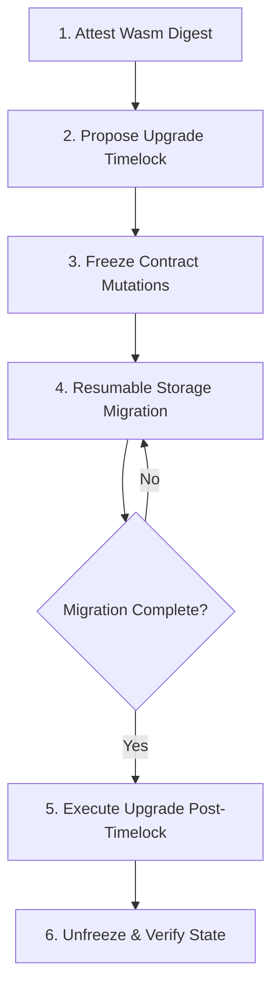

# StreamPay Contract Upgrade & Storage Migration Guide

This document defines the architectural specification, operational procedures, rollback strategies, binary verification matrix, and failure-mode analysis for upgrading the StreamPay smart contract on Stellar (Soroban).

---

## 1. Architectural Decision Record (ADR)

### ADR-001: Upgrade Architecture & Storage Evolution for StreamPay on Soroban

* **Status**: Accepted
* **Context**:
  In Ethereum (EVM), upgradeable contracts commonly rely on the proxy pattern via the `DELEGATECALL` opcode, which executes logic from an implementation contract while reading and writing storage in the proxy context.

  In Stellar's Soroban runtime, **there is no EVM-style `DELEGATECALL`**. Contracts execute in strictly isolated execution environments. Cross-contract calls made via `invoke_contract` switch execution and storage context to the target contract.

  To provide upgradeability for StreamPay while guaranteeing balance conservation and data integrity, we evaluate the two viable architectural options available on Soroban.

### Evaluated Options

#### Option A: Custom Proxy Dispatch (Router / Wrapper Pattern)
A dedicated Proxy contract forwards all incoming invocations to a deployed Implementation contract using `env.invoke_contract(...)`.

* **Trade-offs**:
  * ❌ **CPU & Gas Overhead**: Incurs invocation overhead and cross-contract call footprint on every payment stream interaction (`create_stream`, `withdraw`, `cancel_stream`, `top_up`).
  * ❌ **Authorization Complexity**: Complicates Soroban's declarative `require_auth` tree across contract invocation boundaries.
  * ❌ **State Fragmentation**: Because target execution context owns its own storage, the proxy must either hold raw untyped storage and pass it across call boundaries, or user data must be migrated to the new contract address, breaking external integrations.

#### Option B: Native In-Place Code Upgrade (`update_current_contract`) + Freeze-and-Migrate Pattern (Selected)
Soroban natively provides the `env.deployer().update_current_contract(ContractExecutable::Wasm(new_wasm_hash))` capability. This allows an authorized governance address to update the Wasm bytecode of the contract *in place* without changing the contract address, while preserving all existing ledger storage entries and authorization semantics.

* **Trade-offs**:
  * ✅ **Zero Runtime Overhead**: No proxy indirection or forwarding penalty on hot streaming payment paths.
  * ✅ **Unbroken Integration**: The contract address, token allowances, and external references remain permanent and identical across upgrades.
  * ✅ **Storage Versioning & Safety**: Paired with an explicit `schema_version` key, timelocked governance, and a chunked, resumable `migrate_storage` entrypoint, state migrations can be safely orchestrated on-chain.

### Decision Outcome
We adopted **Option B**: Native in-place upgrade gated by a 24-hour timelock, guarded by contract freeze controls, and orchestrated via an idempotent, resumable storage migration protocol.

---

## 2. Upgrade Lifecycle & Operational Procedure



### Phase 1: Wasm Digest Verification
Before proposing an upgrade on-chain, operators must independently build and verify the bytecode hash:
```bash
cd contracts/streaming-payments
stellar contract build
sha256sum target/wasm32v1-none/release/streampay_contract.wasm
```
Confirm the resulting SHA-256 digest matches the published GitHub Release `UPGRADE_DIGESTS.txt`.

### Phase 2: Proposing Upgrade with Timelock
The governor proposes the upgrade with an enforced delay:
* **Entrypoint**: `propose_upgrade(caller, new_wasm_hash, delay_seconds)`
* **Guard**: `delay_seconds >= MIN_UPGRADE_DELAY_SECONDS` (86,400 seconds / 24 hours).
* **Storage**: Sets `PendingUpgrade { new_wasm_hash, unlock_time }`.
* **Event**: Emits `UpgradeProposed`.

```bash
stellar contract invoke \
  --id <CONTRACT_ID> \
  --source-account <GOVERNOR_SECRET> \
  -- \
  propose_upgrade \
  --caller <GOVERNOR_ADDRESS> \
  --new_wasm_hash <HEX_32_BYTE_WASM_HASH> \
  --delay_seconds 86400
```

### Phase 3: Freezing Contract Mutations
To prevent concurrent state transitions during storage migration, the governor freezes mutating actions:
* **Entrypoint**: `set_frozen(caller, true)`
* **Effect**:
  * Mutating functions (`create_stream`, `withdraw`, `withdraw_max`, `cancel_stream`, `top_up`) immediately revert with `StreamError::ContractFrozen` (code 18).
  * Read-only views (`get_stream`, `available`, `recipient_streams`, `sender_streams`, `treasury_status`, `migration_progress`, `schema_version`) remain fully operational.
* **Event**: Emits `ContractFrozenStateChanged`.

### Phase 4: Executing Resumable Storage Migration
Storage migration is executed in bounded batches to stay well within Soroban CPU and footprint resource limits:
* **Entrypoint**: `migrate_storage(caller, start_id, count)`
* **Batch Size**: `count` is clamped up to `MAX_MIGRATION_BATCH_SIZE = 50`.
* **Resumption**: Passing `start_id = 0` automatically resumes from `migration_cursor + 1`.
* **Idempotency**: Rerunning over an already-processed range is deterministic and safe.
* **Completion**: When `cursor >= total_streams`, `schema_version` is bumped from `1` to `2`.
* **Event**: Emits `StorageMigrated` per batch.

Automated migration loop example:
```bash
while true; do
  STATUS=$(stellar contract invoke --id <CONTRACT_ID> --source-account <GOVERNOR_SECRET> -- migrate_storage --caller <GOVERNOR_ADDRESS> --start_id 0 --count 50)
  echo "Batch migrated: $STATUS"
  if echo "$STATUS" | grep -q '"is_complete":true'; then
    echo "Storage migration fully completed."
    break
  fi
done
```

### Phase 5: Executing Code Upgrade
Once the timelock duration has elapsed (`ledger.timestamp >= pending.unlock_time`), the governor triggers execution:
* **Entrypoint**: `execute_upgrade(caller)`
* **Guards**:
  * Verifies `pending_upgrade` exists (`StreamError::NoPendingUpgrade`).
  * Verifies timelock has expired (`StreamError::TimelockNotExpired`).
* **Effect**:
  * Calls `env.deployer().update_current_contract(ContractExecutable::Wasm(pending.new_wasm_hash))`.
  * Clears `PendingUpgrade`.
* **Event**: Emits `ContractUpgraded`.

### Phase 6: Post-Upgrade Verification and Unfreezing
1. Verify contract views and check migration progress:
   ```bash
   stellar contract invoke --id <CONTRACT_ID> -- schema_version
   # Expected: 2
   ```
2. Unfreeze the contract:
   ```bash
   stellar contract invoke --id <CONTRACT_ID> --source-account <GOVERNOR_SECRET> -- set_frozen --caller <GOVERNOR_ADDRESS> --frozen false
   ```

### Phases 2-6 After Governance Bootstrap

`governance_bootstrap` installs the two-key signer set (issue #119). Once it has
run, the *direct* form of every upgrade step above reverts with
`StreamError::GovernanceTimelockRequired` (code 79) — each step becomes a
proposal that must clear its veto window and collect two distinct signer
signatures. The actions themselves, their events and their guards are
unchanged; only the path to invoking them changes.

| Phase | Direct entry point | Governance action arm |
| --- | --- | --- |
| 2. Propose upgrade | `propose_upgrade` | `GovernanceAction::ProposeUpgrade(hash, delay_seconds)` |
| 3. Freeze | `set_frozen(true)` | *not gated* — see below |
| 4. Migrate storage | `migrate_storage` | `GovernanceAction::MigrateStorage(start_id, count)` |
| 5. Execute upgrade | `execute_upgrade` | `GovernanceAction::ExecuteUpgrade` |
| 6. Unfreeze | `set_frozen(false)` | `GovernanceAction::SetFrozen(false)` |

```bash
# One proposal per step, signed by both keys, executed after the veto window.
stellar contract invoke --id <CONTRACT_ID> --source-account <SIGNER_A> -- \
  governance_propose --caller <SIGNER_A> --action '{"set_frozen":true}'
# -> proposal id 1; then sign, wait out the window, execute.
```

Two carve-outs survive bootstrap because they are risk-*reducing*:

* **`set_frozen(true)` stays immediate.** A timelock on the break-glass is worse
  than no break-glass, so freezing needs only the governor's signature.
  Unfreezing reopens the contract to activity and is therefore proposed.
* **`cancel_upgrade` stays immediate.** Aborting a pending upgrade removes
  authority; the governor calls it directly.

Note that the two clocks are independent and both must expire: a
`ProposeUpgrade` waits out the governance veto window (default 172,800 s)
*and* the wasm hash stays locked until `delay_seconds` after the proposal
executes.

Storage migration is the expensive one under governance: each executed proposal
applies a single batch of at most `MAX_MIGRATION_BATCH_SIZE` (50) streams, and an
executed proposal cannot be replayed, so a 1,000-stream migration is 20
proposals, each with its own veto window. Bootstrap governance *after* the v1→v2
migration for exactly this reason; a contract that still has streams to migrate
and has already bootstrapped should expect the multi-proposal schedule.

---

## 3. Rollback Plan

### Scenario A: Rollback Before Upgrade Execution
If an issue is detected during the 24-hour timelock delay, the governor cancels the pending upgrade:
```bash
stellar contract invoke \
  --id <CONTRACT_ID> \
  --source-account <GOVERNOR_SECRET> \
  -- \
  cancel_upgrade \
  --caller <GOVERNOR_ADDRESS>
```
* **Effect**: Removes `PendingUpgrade` from storage and emits `UpgradeCancelled`.
* **Recovery**: Unfreeze the contract (`set_frozen(false)`) to restore normal operations.

### Scenario B: Rollback During Storage Migration Failure
If a batch migration fails (e.g. node RPC timeout or network interruption):
* Each batch transaction is atomic on Stellar; previously committed batches remain intact.
* Contract remains frozen.
* Operators can inspect `migration_progress` to check the current cursor.
* Once the node/network issue is resolved, resume migration by invoking `migrate_storage(start_id: 0, count: 50)`.

### Scenario C: Post-Execution Rollback (Emergency Revert)
If a critical defect is discovered after `execute_upgrade`:
1. Immediately freeze the contract (`set_frozen(true)`).
2. The governor proposes the previous known-good Wasm hash (`propose_upgrade`).
3. Execute rollback once timelock criteria are satisfied, or through an emergency multisig procedure if configured.

---

## 4. Wasm Digest Verification Matrix

The release pipeline generates reproducible builds and publishes `UPGRADE_DIGESTS.txt` with SHA-256 hashes for both the old and new binaries.

### Verifying Release Artifacts
```bash
# 1. Download released wasm and SHA256SUMS
curl -sSL -O https://github.com/Neziahtech/streampay/releases/download/<TAG>/streampay_contract.wasm
curl -sSL -O https://github.com/Neziahtech/streampay/releases/download/<TAG>/SHA256SUMS

# 2. Check sha256 checksum
sha256sum -c SHA256SUMS

# 3. Compare with on-chain proposal
stellar contract invoke \
  --id <CONTRACT_ID> \
  -- \
  pending_upgrade
```
The `new_wasm_hash` returned by `pending_upgrade` must match byte-for-byte.

---

## 5. Failure-Mode Analysis

| Failure Mode | Trigger / Condition | Contract Behavior & Mitigation |
| :--- | :--- | :--- |
| **Migration Interrupted Mid-Write** | Network partition, gas limit exhaustion, or node timeout during `migrate_storage`. | **Resumable & Atomic**: Stellar transactions are atomic per batch. The `MigrationCursor` accurately records the highest migrated id. Operators simply re-call `migrate_storage(start_id: 0, count: 50)` to resume. |
| **Unfrozen Mutation Attempt During Maintenance** | User calls `create_stream`, `withdraw`, `cancel_stream`, or `top_up` during upgrade. | **Deterministic Rejection**: Entrypoint rejects immediately with `StreamError::ContractFrozen` (#18). Zero balance changes or side effects occur. |
| **Premature Upgrade Attempt** | Governor invokes `execute_upgrade` before the 24h timelock has elapsed. | **Enforced Timelock**: Reverts with `StreamError::TimelockNotExpired` (#21). Proposal remains pending until timestamp condition is met. |
| **Unauthorized Upgrade Proposal** | Non-governor account calls `propose_upgrade`, `execute_upgrade`, `cancel_upgrade`, `set_frozen`, or `migrate_storage`. | **Governance Auth Guard**: Reverts with `StreamError::NotGovernor` (#15). |
| **Double Migration Attempt** | Calling `migrate_storage` after `schema_version >= TARGET_SCHEMA_VERSION`. | **Idempotency Guard**: Reverts with `StreamError::AlreadyMigrated` (#23). Prevents redundant storage rewrites. |
| **Migration Attempt on Unfrozen Contract** | Governor calls `migrate_storage` while contract is still unfrozen. | **State Precondition Guard**: Reverts with `StreamError::ContractNotFrozen` (#19). Enforces that mutations must be halted first. |
